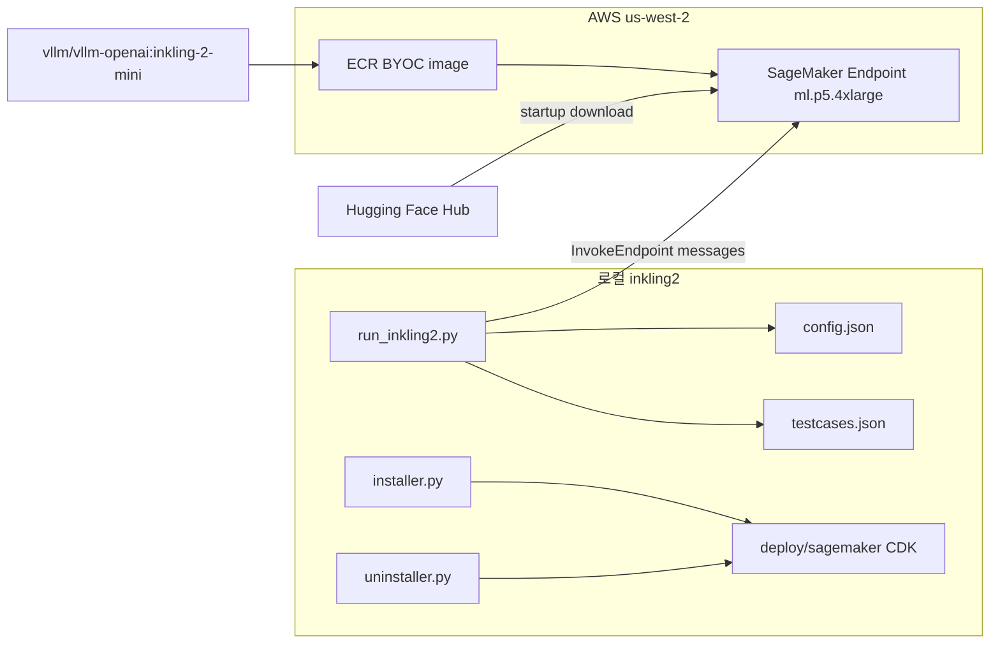

# Inkling-2-Mini on SageMaker (vLLM)

AWS SageMaker에 **[thinkingmachines/Inkling-2-Mini](https://huggingface.co/thinkingmachines/Inkling-2-Mini)** 를 **vLLM**로 배포하고, OpenAI Chat Completions 테스트 케이스로 호출하는 프로젝트입니다.

운영 UX는 패턴(`installer` / `uninstaller` / `config.json` / `testcases`)을 따르되, 컨테이너·API·인스턴스는 Inkling용으로 새로 구성했습니다.

## 목차

- [한 줄 요약](#한-줄-요약)
- [시스템 구성도](#시스템-구성도)
- [디렉터리 구조](#디렉터리-구조)
- [사전 준비](#사전-준비)
- [설치 (installer.py)](#설치-installerpy)
- [실행 (run_inkling2.py)](#실행-run_inkling2py)
- [테스트 케이스](#테스트-케이스-testcasesjson)
- [삭제 (uninstaller.py)](#삭제-uninstallerpy)
- [config.json](#configjson)
- [호출 예제](#호출-예제)
- [비용](#비용)
- [운영 팁](#운영-팁)
- [빠른 시작](#빠른-시작-체크리스트)
- [Reference](#reference)

## 한 줄 요약

| 항목 | 내용 |
| --- | --- |
| 모델 | `thinkingmachines/Inkling-2-Mini` (~20GB, NVFP4/MXFP8, multimodal) |
| 배포 | SageMaker Real-time Endpoint (`deploy/sagemaker` CDK) |
| 런타임 | `vllm/vllm-openai:inkling-2-mini` BYOC + SageMaker `/ping`·`/invocations` 어댑터 |
| 모델 로드 | 컨테이너 기동 시 HF Hub에서 다운로드 (`SM_VLLM_MODEL`) |
| 기본 인스턴스 | `ml.p5.4xlarge` (H100×1, TP1) |
| 리전 기본값 | `us-west-2` |
| 호출 | `boto3` `invoke_endpoint` ← `run_inkling2.py` |
| 케이스 | `testcases.json` (한국어 chat / vision / tool 10개) |

> **하드웨어:** 공식 vLLM/SGLang 레시피는 Hopper·Blackwell·DGX Spark 등을 검증했습니다. **`ml.g5`(A10G)로는 NVFP4 loop 서빙이 불가**합니다.

## 시스템 구성도



요청 본문에 `messages`가 있으면 `/v1/chat/completions`, `prompt`가 있으면 `/v1/completions`로 라우팅됩니다.

## 디렉터리 구조

```text
inkling2/
├── README.md
├── installer.py
├── uninstaller.py
├── run_inkling2.py
├── testcases.json
├── config.json.example
├── requirements.txt
└── deploy/sagemaker/
    ├── bin/cdk-app.ts
    ├── lib/inkling-endpoint-stack.ts
    ├── scripts/fetch-model.ts
    ├── Dockerfile
    ├── sagemaker_entrypoint.py
    ├── serve.sh
    ├── cdk.json
    └── package.json
```

## 사전 준비

| 요구사항 | 설명 |
| --- | --- |
| AWS 자격 증명 | SageMaker / CloudFormation / IAM / S3 / CodeBuild / ECR |
| Node.js 22+ | `npx cdk` |
| Python 3.10+ | `boto3` |
| SageMaker 쿼터 | `ml.p5.4xlarge for endpoint usage` ≥ 1 |

```bash
pip install -r requirements.txt
cd deploy/sagemaker && npm install && cd ../..
```

CDK bootstrap은 `installer.py`가 리전별로 없을 때 자동 실행합니다.

## 설치 (installer.py)

```bash
python installer.py

# 옵션
python installer.py --region us-west-2
python installer.py --instance-type ml.p5.4xlarge
python installer.py --tensor-parallel-size 1
python installer.py --enable-dspark          # DSpark speculative (기본 off)
python installer.py --skip-smoke
```

설치 단계:

1. `config.json` 생성/갱신  
2. `deploy/sagemaker`에서 `npm install`  
3. 필요 시 `cdk bootstrap`  
4. `cdk deploy` — BYOC 이미지 빌드 + Endpoint  
5. 스모크 (짧은 한국어 chat)

배포에는 이미지 빌드·엔드포인트 기동·**기동 시 HF 모델 다운로드**로 **수십 분** 걸릴 수 있습니다.  
(대용량 가중치를 CodeBuild로 미리 sync하면 60분 타임아웃에 걸리기 쉬워, 런타임 Hub 다운로드를 사용합니다.)

설치 후 확인:

```bash
aws sagemaker describe-endpoint \
  --endpoint-name inkling-2-mini \
  --region us-west-2 \
  --query EndpointStatus
# InService
```

## 실행 (run_inkling2.py)

```bash
python run_inkling2.py
python run_inkling2.py --list
python run_inkling2.py --only 1,4,5
python run_inkling2.py --config ./config.json --cases ./testcases.json
```

각 케이스의 OpenAI body를 `invoke_endpoint`로 보내고 `content` / `reasoning` / `tool_calls` / latency를 출력합니다.

## 테스트 케이스 (`testcases.json`)

| # | 이름 | 내용 |
| --- | --- | --- |
| 01 | greeting_ko | 짧은 한국어 지시 |
| 02 | python_fizzbuzz | 코드 생성 |
| 03 | summarize_ko | 요약 |
| 04 | multiturn | 멀티턴 맥락 |
| 05 | vision_describe | 이미지+텍스트 |
| 06 | tool_weather | tool calling |
| 07 | reasoning_bounded | 추론 + max_tokens |
| 08 | refusal_boundary | 안전 거절 |
| 09 | json_extract | 구조화 출력 |
| 10 | code_explain_ko | 코드 설명 |

`expect` 필드는 수동 검증 힌트이며, 자동 assert는 하지 않습니다.

## 삭제 (uninstaller.py)

```bash
python uninstaller.py          # 확인 프롬프트
python uninstaller.py --yes    # 확인 없이 삭제
```

> Real-time Endpoint는 **요청 0건이어도 인스턴스 시간당 과금**됩니다. 실험이 끝나면 즉시 삭제하세요.

## config.json

`installer.py`가 생성합니다. **gitignore** 대상입니다. 템플릿: `config.json.example`.

주요 필드:

```json
{
  "project": "inkling2",
  "region": "us-west-2",
  "model": {
    "hub_id": "thinkingmachines/Inkling-2-Mini",
    "revision": "main"
  },
  "sagemaker": {
    "endpoint_name": "inkling-2-mini",
    "instance_type": "ml.p5.4xlarge",
    "cdk_context": {
      "tensor_parallel_size": 1,
      "max_model_len": 65536,
      "enable_dspark": false
    }
  }
}
```

## 호출 예제

```python
import json
import boto3

runtime = boto3.client("sagemaker-runtime", region_name="us-west-2")
body = {
    "model": "thinkingmachines/Inkling-2-Mini",
    "messages": [
        {"role": "user", "content": "한 문장으로 자기소개를 해주세요."},
    ],
    "max_tokens": 64,
}
resp = runtime.invoke_endpoint(
    EndpointName="inkling-2-mini",
    ContentType="application/json",
    Body=json.dumps(body, ensure_ascii=False, sort_keys=True).encode("utf-8"),
)
print(json.loads(resp["Body"].read()))
```

서버 플래그(컨테이너 env):

- `--reasoning-parser inkling`
- `--tool-call-parser inkling`
- `--enable-auto-tool-choice`
- `--tensor-parallel-size` ← `SM_VLLM_TENSOR_PARALLEL_SIZE` (기본 1)
- DSpark는 `enable_dspark=true`일 때만 활성

## 비용

`ml.p5.4xlarge`(H100×1) Real-time Hosting도 **시간당 과금**이 큽니다(리전·시점별 Price List 확인). 24/7 방치 시 월 비용이 커지므로 실험 후 즉시 삭제하세요.

| 시나리오 | 권장 |
| --- | --- |
| 스모크·테스트 | 배포 → `run_inkling2.py` → **즉시** `uninstaller.py --yes` |
| 상시 API | Savings Plans / 별도 용량 계획 필요 |

부가 비용: S3 모델(~20GB+), CodeBuild(배포 1회), CloudWatch Logs, ECR 저장.

## 운영 팁

- **쿼터:** Service Quotas에서 `ml.p5.4xlarge for endpoint usage` 확인.  
- **AMI:** CUDA 13 이미지용 `al2023-ami-sagemaker-inference-gpu-4-1`.  
- **기동 시간:** health check timeout 1800s — 모델 로드가 깁니다.  
- **반복 루프:** Inkling은 reasoning 루프에 빠질 수 있어 `max_tokens`를 제한하세요.  
- **로그:**

```bash
aws logs tail /aws/sagemaker/Endpoints/inkling-2-mini \
  --region us-west-2 --since 1h --follow
```

## 빠른 시작 체크리스트

```bash
# 1) 배포 (비용 주의)
python installer.py

# 2) 케이스 실행
python run_inkling2.py --list
python run_inkling2.py

# 3) 과금 중단
python uninstaller.py --yes
```

## Reference

- 모델: https://huggingface.co/thinkingmachines/Inkling-2-Mini  
- vLLM recipe: https://recipes.vllm.ai/thinkingmachines/Inkling-2-Mini  
- vLLM day-0 블로그: https://vllm.ai/blog/2026-11-20-inkling2-mini  
- AWS vLLM SageMaker DLC (참고): https://aws.github.io/deep-learning-containers/vllm/deployment/sagemaker/  
- UX 참조: `strands-decider-kr` (System One / strands-decider DLC — 본 레포와 API·컨테이너가 다름)
