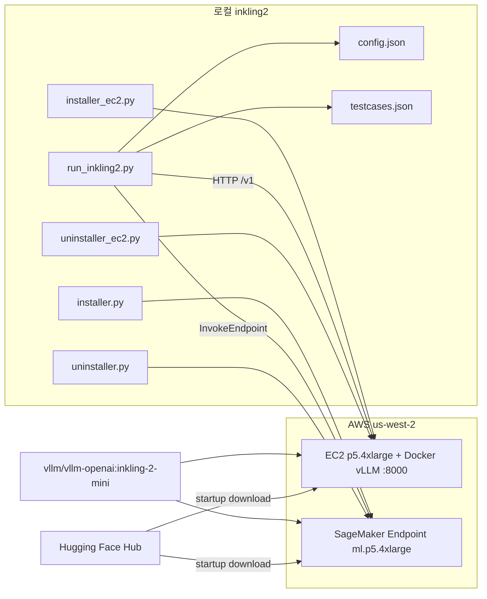

# Inkling-2-Mini on AWS (vLLM)

AWS에 **[thinkingmachines/Inkling-2-Mini](https://huggingface.co/thinkingmachines/Inkling-2-Mini)** 를 **vLLM**로 배포하고, OpenAI Chat Completions 테스트 케이스로 호출하는 프로젝트입니다.

**권장 경로:** SageMaker Real-time은 us-west-2에서 `InsufficientInstanceCapacity`가 반복되어, **EC2 GPU (`installer_ec2.py`)** 로 직접 올리는 방식을 기본 대안으로 둡니다. SageMaker 경로(`installer.py`)도 그대로 유지합니다.

## 목차

- [한 줄 요약](#한-줄-요약)
- [시스템 구성도](#시스템-구성도)
- [디렉터리 구조](#디렉터리-구조)
- [사전 준비](#사전-준비)
- [설치 EC2 (installer_ec2.py)](#설치-ec2-installer_ec2py)
- [설치 SageMaker (installer.py)](#설치-sagemaker-installerpy)
- [실행 (run_inkling2.py)](#실행-run_inkling2py)
- [테스트 케이스](#테스트-케이스-testcasesjson)
- [삭제](#삭제)
- [config.json](#configjson)
- [호출 예제](#호출-예제)
- [비용](#비용)
- [운영 팁](#운영-팁)
- [빠른 시작](#빠른-시작-체크리스트)
- [Reference](#reference)

## 한 줄 요약

| 항목 | 내용 |
| --- | --- |
| 모델 | `thinkingmachines/Inkling-2-Mini` (~20GB, NVFP4/MXFP8, multimodal) |
| 권장 배포 | **EC2** `p5.4xlarge` + `vllm/vllm-openai:inkling-2-mini` (`deploy/ec2`) |
| 대안 배포 | SageMaker Real-time (`deploy/sagemaker`, 용량 부족 시 실패 가능) |
| 모델 로드 | 컨테이너 기동 시 HF Hub 다운로드 |
| 기본 인스턴스 | EC2 `p5.4xlarge` / SageMaker `ml.p5.4xlarge` |
| 리전 기본값 | `us-west-2` |
| 호출 | EC2: HTTP `/v1/chat/completions` · SageMaker: `InvokeEndpoint` |
| 케이스 | `testcases.json` (한국어 chat / vision / tool 10개) |

> **하드웨어:** Inkling-2-Mini NVFP4는 GPU capability ≥ 90(Hopper/Blackwell)이 필요합니다.

## 시스템 구성도



## 디렉터리 구조

```text
inkling2/
├── README.md
├── installer_ec2.py          # 권장: EC2 배포
├── uninstaller_ec2.py
├── installer.py              # SageMaker 배포
├── uninstaller.py
├── run_inkling2.py           # EC2 HTTP 또는 SageMaker
├── testcases.json
├── config.json.example
├── requirements.txt
├── deploy/ec2/               # CDK: VPC(default) + GPU EC2 + user-data
└── deploy/sagemaker/         # CDK: BYOC + Real-time Endpoint
```

## 사전 준비

| 요구사항 | 설명 |
| --- | --- |
| AWS 자격 증명 | EC2 / CloudFormation / IAM / (SageMaker 경로 시 SM·ECR·CodeBuild) |
| Node.js 22+ | `npx cdk` |
| Python 3.10+ | `boto3` |
| 쿼터 | EC2 `p5.4xlarge` On-Demand (또는 선택한 GPU 타입) |

```bash
pip install -r requirements.txt
```

CDK bootstrap은 installer가 리전별로 없을 때 자동 실행합니다.

## 설치 EC2 (installer_ec2.py)

```bash
python installer_ec2.py

# 옵션
python installer_ec2.py --region us-west-2
python installer_ec2.py --instance-type p5.4xlarge
python installer_ec2.py --allowed-cidr 203.0.113.10/32   # API 접근 제한
python installer_ec2.py --tensor-parallel-size 1
python installer_ec2.py --skip-smoke
```

기본 `allowed_cidr`는 설치 머신의 공인 IP `/32`입니다. (`checkip.amazonaws.com`)

설치 단계:

1. `config.json`의 `ec2` 섹션 생성/갱신  
2. `deploy/ec2`에서 `npm install`  
3. 필요 시 `cdk bootstrap`  
4. `cdk deploy` — DLAMI + Docker + `vllm/vllm-openai:inkling-2-mini`  
5. `/v1/models` ready 대기 후 스모크

기동 시 HF 모델 다운로드로 **수십 분** 걸릴 수 있습니다. SSM으로 인스턴스에 붙어 `docker logs -f inkling-vllm` / `/var/log/inkling-bootstrap.log`를 확인하세요.

## 설치 SageMaker (installer.py)

```bash
python installer.py
python installer.py --instance-type ml.p5.4xlarge
python installer.py --fallback-instance-types ml.g5.xlarge   # 용량용, NVFP4 비호환
```

> SageMaker에서 용량 부족이 반복되면 `installer_ec2.py`를 사용하세요.

## 실행 (run_inkling2.py)

`config.ec2.base_url`이 있으면 EC2 HTTP를, 없으면 SageMaker endpoint를 사용합니다.

```bash
python run_inkling2.py
python run_inkling2.py --list
python run_inkling2.py --only 1,4,5
```

## 테스트 케이스 (`testcases.json`)

| # | 이름 | 내용 |
| --- | --- | --- |
| 01 | greeting_ko | 짧은 한국어 지시 |
| 02 | python_fizzbuzz | 코드 생성 |
| 03 | summarize_ko | 요약 |
| 04 | multiturn | 멀티턴 맥락 |
| 05 | vision_describe | 이미지+텍스트 |
| 06 | tool_weather | tool calling |
| 07 | reasoning_bounded | 추론 + max_tokens |
| 08 | refusal_boundary | 안전 거절 |
| 09 | json_extract | 구조화 출력 |
| 10 | code_explain_ko | 코드 설명 |

`expect` 필드는 수동 검증 힌트이며, 자동 assert는 하지 않습니다.

## 삭제

```bash
python uninstaller_ec2.py --yes    # EC2
python uninstaller.py --yes        # SageMaker
```

> 인스턴스/엔드포인트는 **요청 0건이어도 시간당 과금**됩니다. 실험이 끝나면 즉시 삭제하세요.

## config.json

installer가 생성합니다. **gitignore** 대상입니다. 템플릿: `config.json.example`.

EC2 주요 필드:

```json
{
  "region": "us-west-2",
  "model": { "hub_id": "thinkingmachines/Inkling-2-Mini" },
  "ec2": {
    "stack_name": "inkling-2-mini-ec2",
    "instance_type": "p5.4xlarge",
    "base_url": "http://x.x.x.x:8000/v1",
    "status": "InService"
  }
}
```

## 호출 예제

EC2 (OpenAI-compatible):

```python
import json
import urllib.request

body = {
    "model": "thinkingmachines/Inkling-2-Mini",
    "messages": [{"role": "user", "content": "한 문장으로 자기소개를 해주세요."}],
    "max_tokens": 64,
}
req = urllib.request.Request(
    "http://PUBLIC_IP:8000/v1/chat/completions",
    data=json.dumps(body).encode("utf-8"),
    headers={"Content-Type": "application/json"},
    method="POST",
)
print(json.load(urllib.request.urlopen(req)))
```

서버 플래그:

- `--reasoning-parser inkling`
- `--tool-call-parser inkling`
- `--enable-auto-tool-choice`
- `--tensor-parallel-size` (기본 1)

## 비용

`p5.4xlarge` / `ml.p5.4xlarge` 모두 **시간당 과금**이 큽니다. 실험 후 즉시 삭제하세요.

| 시나리오 | 권장 |
| --- | --- |
| 스모크·테스트 | 배포 → `run_inkling2.py` → **즉시** uninstaller |
| 상시 API | 별도 용량·보안(CIDR/ALB/인증) 계획 |

## 운영 팁

- **쿼터:** EC2 `Running On-Demand P instances` / SageMaker endpoint 쿼터를 각각 확인.  
- **보안:** `--allowed-cidr`로 API 포트를 제한하세요. SSM으로 디버깅(SSH 키 불필요).  
- **기동 시간:** 모델 Hub 다운로드 + vLLM 로드에 오래 걸립니다.  
- **반복 루프:** `max_tokens`를 제한하세요.

## 빠른 시작 체크리스트

```bash
# 1) EC2 배포 (비용 주의)
python installer_ec2.py

# 2) 케이스 실행
python run_inkling2.py --list
python run_inkling2.py

# 3) 과금 중단
python uninstaller_ec2.py --yes
```

## Reference

- 모델: https://huggingface.co/thinkingmachines/Inkling-2-Mini  
- vLLM recipe: https://recipes.vllm.ai/thinkingmachines/Inkling-2-Mini  
- vLLM day-0 블로그: https://vllm.ai/blog/2026-11-20-inkling2-mini  
- AWS vLLM SageMaker DLC (참고): https://aws.github.io/deep-learning-containers/vllm/deployment/sagemaker/
